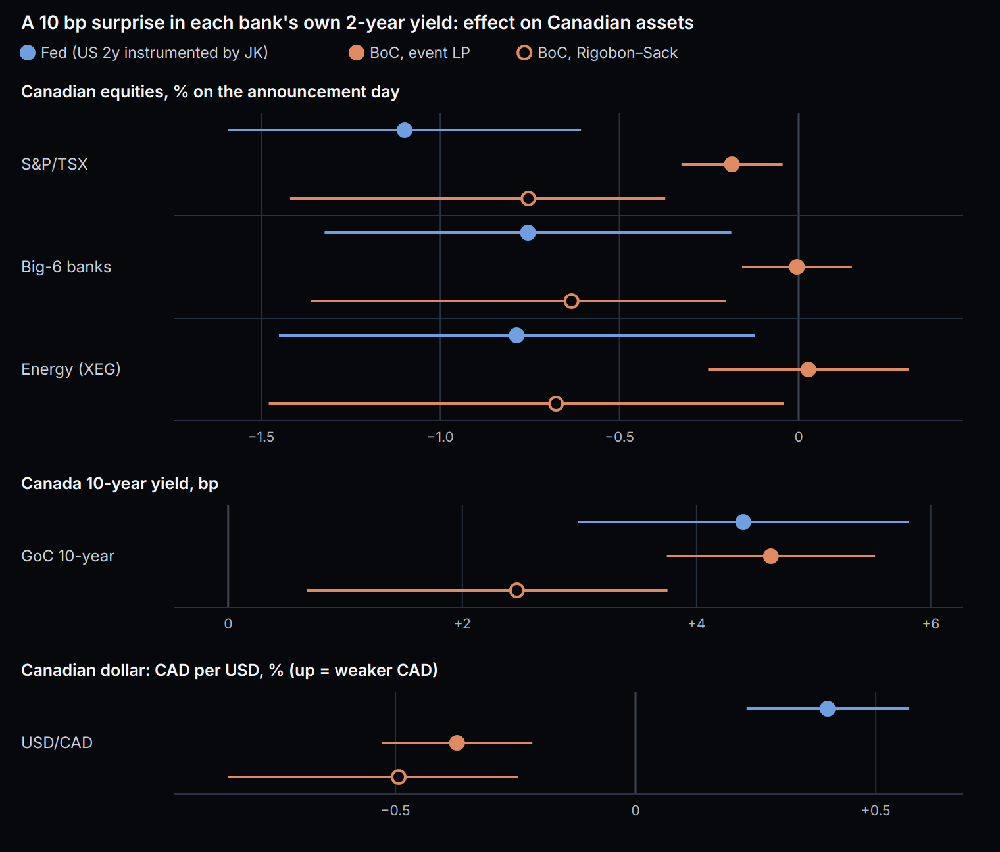
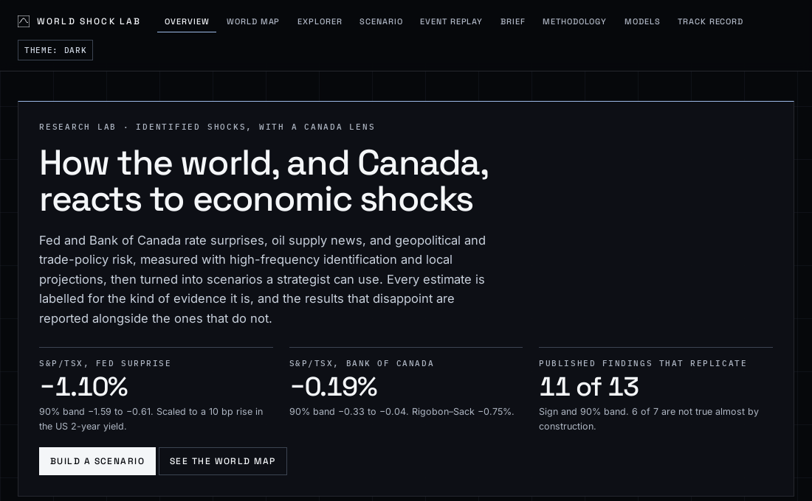
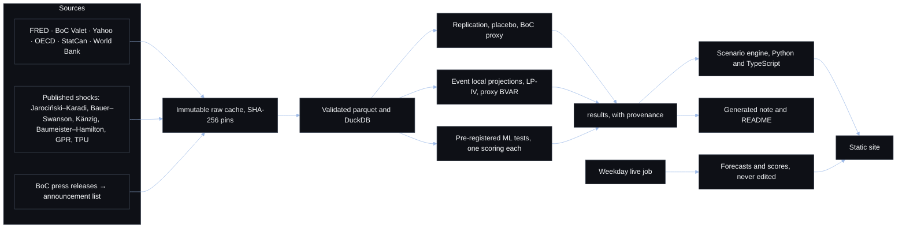
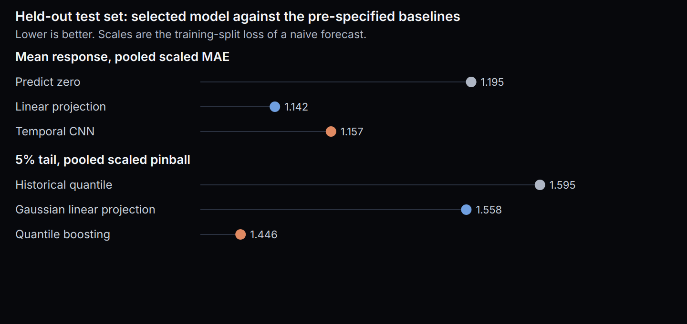

# World Shock Lab

[](https://github.com/shmorsi/world-shock-lab/actions/workflows/ci.yml)
[](LICENSE)
[](https://www.python.org/downloads/)
[](https://shmorsi.github.io/world-shock-lab/)

Identified Fed, Bank of Canada and OPEC surprises, a pre-registered test of whether a neural net beats a linear projection, and a scenario tool that can only print a number the estimates contain.

<a href="https://shmorsi.github.io/world-shock-lab/"></a>

## Key results

<!-- top:start (generated by `uv run wsl report docs`; do not edit) -->
Across 53 assets. Each central-bank surprise below is scaled to a 10 bp rise in that country's 2-year yield.

| Result | Estimate | Label |
|---|---|---|
| S&P/TSX, Fed surprise | −1.10% (90% band −1.59 to −0.61) | Identified causal |
| S&P/TSX, Bank of Canada surprise | −0.19% (90% band −0.33 to −0.04); Rigobon–Sack −0.75% (−1.42 to −0.37) | Identified causal |
| Mean forecast, temporal CNN minus a linear projection | +0.015 (90% CI −0.006 to +0.037) on 168 held-out announcements | Model forecast. No evidence ML adds value |
| 5% pinball, quantile boosting minus a Gaussian | −0.112 (90% CI −0.228 to −0.010). The quantile is crossed 9.0% of the time | Model forecast. ML adds value on the 5% tail |
| Published findings that replicate | 11 of 13, sign and 90% band | Credibility check |
| Live forecasts | Forecasts for the 2026-10-28 Fed and BoC decisions were committed on 2026-10-13, before the decisions. No decision has been scored yet, so there is no track record. | Model forecast |
<!-- top:end -->

**Open:** [the site](https://shmorsi.github.io/world-shock-lab/) · [research note (PDF)](docs/RESEARCH_NOTE.pdf) · [all results](docs/RESULTS.md) · [ML study](docs/ML_STUDY.md) · [replication](docs/REPLICATION.md) · [limitations](docs/LIMITATIONS.md)

[](https://shmorsi.github.io/world-shock-lab/)

## Why this matters

A price regression cannot tell a Fed surprise from the rest of the day's news. The surprises here are measured in a short window around a scheduled announcement, checked against the published papers, and labelled for the kind of claim they support: identified causal, reduced form, model forecast, or hypothetical scenario. The machine-learning comparison was tagged in git before the test set was opened, including the rule for a disappointing answer. That answer is what the first benchmark returned. The tail result is one pre-registered score, and the calibration miss is reported beside it. The scenario brief is template text; a test fails if it prints a digit the results do not contain.

## Architecture



- **Data** (`wsl/data/`): each download is stored once, read-only, and pinned in `data/manifest.json`. A revised source fails the build instead of silently changing a number.
- **Timing** (`wsl/timing.py`): each series uses its own observation clock. A 14:00 statement is not in a noon exchange-rate fix until the next print.
- **Estimation** (`wsl/estimation/`, `wsl/analysis/`): event-sample local projections, LP-IV, a Minnesota proxy BVAR, and state-dependent projections with a wild cluster bootstrap. Each estimator was checked by Monte Carlo first ([docs/SIMULATION.md](docs/SIMULATION.md)).
- **Models** (`wsl/ml/`, `wsl/mlstudy/`): a per-asset network benchmark, then a separate study of a temporal CNN and quantile boosting ([docs/EVALUATION_PROTOCOL.md](docs/EVALUATION_PROTOCOL.md), [docs/ML_STUDY_PROTOCOL.md](docs/ML_STUDY_PROTOCOL.md)).
- **Scenarios** (`wsl/scenarios/`, `web/src/engine/`): one engine, two languages, shared fixtures.
- **Live mode** (`wsl/live/`, [`.github/workflows/live.yml`](.github/workflows/live.yml)): a forecast before each Fed and Bank of Canada decision. The job reads `FRED_API_KEY` from the Actions secret and fails if the secret is missing.

## Quick start

[uv](https://docs.astral.sh/uv/getting-started/installation/) installs the pinned Python. The site needs Node 22 (`web/.nvmrc`). These three commands do not need an API key.

```bash
make setup
make reproduce
cd web && npm ci && npm run dev
```

`make reproduce` lints, typechecks, tests, and regenerates the documents from the committed results. It does not refit a model or download data. A full rebuild from the sources is `make all`, after a free FRED key is in `.env` ([docs/REPRODUCING.md](docs/REPRODUCING.md)).

## Reproducibility and integrity

- **Pre-registration.** Splits, metrics and decision rules are in `config/evaluation.yaml` and `config/live.yaml`, tagged `protocol-v1` through `protocol-v4` before the fitting those tags govern. The second study has its own tag, `ml-study-v1`.
- **One look at each test set.** `wsl evaluate --final` and `wsl mlstudy --final` refuse a second run unless a reason is logged. The committed files in `results/final_eval/` and `results/mlstudy/` are the record.
- **Locked outputs.** Published forecasts in `live/forecasts/` and scores in `live/scores/` are write-once. Result files carry the input hashes, the code version and the protocol hash. Do not edit them by hand. [docs/DEV.md](docs/DEV.md) lists the files a change should leave alone.
- **CI.** Every pull request runs ruff, mypy, pytest, the web typecheck, the web tests, the production build, and axe-core. The Pages workflow builds the same site from the committed data and deploys it from `main`.
- **Compute.** The lockfile installs CPU torch. The committed scores are the record, and the result files do not store a wall-clock for those fits, so none is stated. `make reproduce` does not train.

## What I'd do next

Future work, not a result. A language agent could draft the strategist brief from the catalogue, still forbidden by the existing test from printing a digit the engine did not compute. A new protocol tag could ask whether conformal or regime-conditional quantiles calibrate the tail, without reopening the frozen tests. A larger model would be that kind of new protocol, with its own tag, and would not replace the scores above. Live mode could add another central bank once a public surprise and a licence that allows the score file both exist. None of that is in the estimates above.

## Results

<!-- findings:start (generated by `uv run wsl report docs`; do not edit) -->
### Headline findings

1. **Canadian stocks react more to the Fed than to the Bank of Canada.** Scaling each surprise so it lifts its own country's 2-year yield by 10 bp, the S&P/TSX moves −1.10% on the day of a Fed move (90% band −1.59 to −0.61) but −0.19% after a BoC move (−0.33 to −0.04), or −0.75% (−1.42 to −0.37) with the Rigobon–Sack estimator. Yields and the currency respond about equally to both: the Canadian 10-year yield rises +4.40 bp after the Fed and +4.64 bp after the BoC, and the Canadian dollar moves by similar amounts in opposite directions (CAD per USD +0.40% after a Fed hike surprise, −0.37% after a BoC one). *Identified causal; the size of the Fed's lead depends on the estimator, its direction does not.*
2. **No evidence that machine learning adds value (first benchmark).** On 168 held-out announcements (2019–2026), scored once under a protocol tagged in git before any model was fitted, the neural network's pooled scaled error minus the linear local projection's is −0.003 (90% CI −0.019 to +0.014). The best model's error (1.139) barely improves on predicting no move (1.195). *Model forecast; a disappointing result, reported as pre-registered.*
3. **No regime effect survives multiple-testing control.** Of 80 pre-registered tests of whether the same shock matters more when volatility or inflation is high, or across the policy cycle, 15 have p ≤ 0.10 before correction (about 8 expected by chance) and none survives Benjamini–Hochberg at q = 0.10. *The sample can only see large regime differences; the minimum detectable effects are reported with every test.*

**Why trust the numbers:** 11 of 13 published findings replicate (sign and 90% band), including 6 of the 7 that are not true almost by construction. In simulation, the primary estimator's 90% bands contain the true response 90% of the time. 24 of 30 headline responses keep their sign in every pre-registered robustness variant and stay significant in at least two thirds of them.

**Site:** every view renders in 2.7 s or less on a throttled phone profile (slow 4G, CPU slowed four times; `npm run measure`), and axe-core finds 0 WCAG 2.1 A/AA violations across 9 views in light and dark themes.
<!-- findings:end -->

<!-- tldr:start (generated by `uv run wsl report docs`; do not edit) -->
### Second ML study

A second, pre-registered study asks whether a pooled neural model or a quantile model beats a linear projection. The econometrics stay as they were.

On 168 held-out announcements (2019–2026), the temporal CNN's pooled scaled error minus the linear projection's is +0.015 (90% CI −0.006 to +0.037): No evidence ML adds value.

Quantile gradient boosting's 5% pinball loss minus the Gaussian linear projection's is −0.112 (90% CI −0.228 to −0.010): ML adds value on the 5% tail.



| Question | Selected model | Score | Baseline | Difference (90% CI) | Verdict |
|---|---|---:|---:|---|---|
| Mean, pooled scaled MAE | Temporal CNN | 1.157 | linear 1.142 | +0.015 (−0.006 to +0.037) | No evidence ML adds value |
| Mean, predict zero | — | 1.195 | — | — | reported |
| 5% pinball | Quantile boosting | 1.446 | Gaussian 1.558 | −0.112 (−0.228 to −0.010) | ML adds value on the 5% tail |
| 5% pinball, historical | — | 1.595 | — | — | reported |

Reproduce the checks and these documents from the committed results with `make reproduce`. That command does not refit the test set.
<!-- tldr:end -->

<!-- learned:start (generated by `uv run wsl report docs`; do not edit) -->
### What I built and learned

I kept the replications, the scenario site and the first machine-learning test exactly as published, and added a second study with its own config file and git tag. The new models are a multi-task network and a temporal CNN for the average move, and quantile gradient boosting and a quantile network for the left tail. Validation, 74 announcements, picked the model. The test set was scored once.

The average move is still the linear surprise. Every network lost to the linear projection on validation (the chosen CNN 0.885 against 0.836). On the test set the difference is +0.015, and the interval includes zero, so the pre-registered rule says there is no evidence the network adds value. A single fit through the validation window, which cannot change that verdict, is worse: +0.026 (90% CI +0.006 to +0.046). Grouped Shapley values put 45% of the mean absolute contribution on the surprise and 9% on the pre-event path. With a few hundred announcements, a flexible model has little left to learn.

The tail is a different question, and there the flexible model wins on the score that was named in advance. Quantile boosting's scaled pinball loss is 1.446 against 1.558 for a Gaussian residual around the linear projection and 1.595 for the historical quantile. The difference is −0.112, and the whole 90% interval is below zero. That is not the same as a well-calibrated 5% forecast: outcomes fall below the predicted quantile 9.0% of the time, against 6.3% for the Gaussian, and the boosting model's central interval covers 83.5% of outcomes against 88.7% for the Gaussian. The win is the pinball loss. Calibration was reported and was not allowed to change the verdict.

Two secondary checks did not rescue the average-move model or extend the tail result. Asset embeddings fit through the validation window do not recover the pre-specified groups (adjusted Rand index 0.22, permutation p 0.18). On a fixed equity book the tail model's pinball difference is −0.216 (90% CI −0.552 to +0.092), which includes zero. The Fissler–Ziegel average is reported in the study note and is not used: yields are in basis points and equities in percent, and an exponential score lets one cell dominate.

The comparison uses this checkout's data vintage: 3 artifacts matched the committed pins and 22 market series had been revised by the source. Shock files are among the matched artifacts. The linear projection's test scaled error on this vintage is 1.142.
<!-- learned:end -->

## Limits

The full list, with reasons, is in [docs/LIMITATIONS.md](docs/LIMITATIONS.md).

### What this is, and what it is not

| It is | It is not |
|---|---|
| Causal estimates where identification supports them: 30-minute Fed surprises, OPEC announcement surprises, and a Bank of Canada proxy that was validated before use | A forecast of what markets will do. Scenarios are conditional and hypothetical |
| Reduced-form associations for geopolitical and trade-policy risk, labelled as such | Investment advice |
| Two pre-registered, once-only tests of machine learning against econometrics: no gain on the average move, a gain on the 5% tail pinball loss only | Evidence that effects differ by regime: the pre-registered tests found nothing that survives correction |
| Scenarios that add estimated responses, with uncertainty and explicit warnings about linearity and out-of-range sizes | Reliable for monthly macro effects: those instruments are weak |
| Live forecasts published before each Fed and BoC decision and scored automatically | A track record yet: the first live decisions are in late 2026 |

Every output carries one of four labels: **identified causal**, **reduced form**, **model forecast** or **hypothetical scenario**.

## Repository map

| Path | What it is |
|---|---|
| [docs/RESEARCH_NOTE.md](docs/RESEARCH_NOTE.md) / [.pdf](docs/RESEARCH_NOTE.pdf) | The research note, generated from the results |
| [docs/PLAN.md](docs/PLAN.md) | Scope, push-backs on the original brief, risks, milestones |
| [docs/EVALUATION_PROTOCOL.md](docs/EVALUATION_PROTOCOL.md) | The pre-registered protocol and its change log (git tags `protocol-v1` to `protocol-v4`) |
| [data/SOURCES.md](data/SOURCES.md) | Every source: verified URL, coverage, licence, redistribution policy, open items |
| [docs/DATA_QUALITY.md](docs/DATA_QUALITY.md), [docs/SIMULATION.md](docs/SIMULATION.md), [docs/REPLICATION.md](docs/REPLICATION.md), [docs/RESULTS.md](docs/RESULTS.md), [docs/ML_BENCHMARK.md](docs/ML_BENCHMARK.md) | Generated reports: data quality, estimator validation, replication, the M4 results, the ML benchmark |
| [docs/LIMITATIONS.md](docs/LIMITATIONS.md) | What the results cannot tell you |
| [docs/REPRODUCING.md](docs/REPRODUCING.md) | One-command reproduction, and what changes when sources revise their data |
| [docs/DEV.md](docs/DEV.md) | How to set up, what the checks run, and which files stay untouched |
| [docs/RESUME_BULLETS.md](docs/RESUME_BULLETS.md) | Generated summary bullets and interview questions with honest answers |
| [CITATION.cff](CITATION.cff) | Software citation |
| [docs/SHIP_CHECKLIST.md](docs/SHIP_CHECKLIST.md) | The decisions and steps left for the owner before going public |
| [docs/COMMIT_MAP.md](docs/COMMIT_MAP.md) | Old to current commit hashes (history rewritten twice, for attribution only; contents unchanged) |
| `results/` | Result files with provenance (input hashes, code version, protocol hash, evidence label) |
| `live/` | Pre-registered live forecasts and their scores |
| `config/` | Series registry, evaluation protocol, live-mode rules |
| `wsl/` | The Python package (`uv run wsl --help`) |
| `web/` | The static web app (Vite, React, TypeScript, d3) |

## Citations

Shocks: Jarociński and Karadi (2020, *AEJ: Macroeconomics*), Bauer and Swanson (2023, *NBER Macroeconomics Annual*), Känzig (2021, *AER*), Baumeister and Hamilton (2019, *AER*), Caldara and Iacoviello (2022, *AER*), Caldara, Iacoviello, Molligo, Prestipino and Raffo (2020, *JME*). Methods: Jordà (2005), Rigobon and Sack (2004), Montiel Olea and Pflueger (2013), Anderson and Rubin (1949), Jentsch and Lunsford (2019), Benjamini and Hochberg (1995), Plagborg-Møller and Wolf (2021). Full references are in the [research note](docs/RESEARCH_NOTE.md#references), and data sources with licences in [data/SOURCES.md](data/SOURCES.md).

## Licence

Code: MIT ([LICENSE](LICENSE)). Cite the software with [CITATION.cff](CITATION.cff). Data: each provider's terms, as listed in [data/SOURCES.md](data/SOURCES.md). Raw data are never committed. Yahoo prices are published only as derived statistics. Nothing derived from VIX or Moody's spreads is published (open item O-9). Fonts: Space Grotesk, Inter, and IBM Plex Mono (SIL Open Font License), bundled with the site. World map: Natural Earth via world-atlas (public domain).

This product uses the FRED® API but is not endorsed or certified by the Federal Reserve Bank of St. Louis. Nothing here is investment advice.
