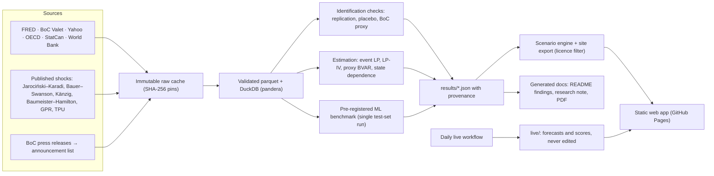

# World Shock Lab

**How the world, and Canada in particular, reacts to economic shocks.** World Shock Lab measures how markets respond to Fed and Bank of Canada rate surprises, oil supply news, and geopolitical and trade-policy risk. It uses high-frequency identification and local projections, validated by simulation and replication, and pre-registers its tests. The results feed a scenario tool a strategist can use. Every number is produced by the code in this repository, and every result is labelled for the kind of evidence it is.


**Read:** [research note (PDF)](docs/RESEARCH_NOTE.pdf) · [research note (Markdown)](docs/RESEARCH_NOTE.md) · [all results](docs/RESULTS.md) · [ML benchmark](docs/ML_BENCHMARK.md) · [replication](docs/REPLICATION.md) · [limitations](docs/LIMITATIONS.md)
**Use:** the static web app in `web/`, deployed to GitHub Pages by `.github/workflows/pages.yml` (see [docs/SHIP_CHECKLIST.md](docs/SHIP_CHECKLIST.md) for the live link).

<!-- findings:start (generated by `uv run wsl report docs`; do not edit) -->
### Headline findings

1. **Canadian stocks react more to the Fed than to the Bank of Canada.** Scaling each surprise so it lifts its own country's 2-year yield by 10 bp, the S&P/TSX moves −1.10% on the day of a Fed move (90% band −1.59 to −0.61) but −0.19% after a BoC move (−0.33 to −0.04), or −0.75% (−1.42 to −0.37) with the Rigobon–Sack estimator. Yields and the currency respond about equally to both: the Canadian 10-year yield rises +4.40 bp after the Fed and +4.64 bp after the BoC, and the Canadian dollar moves by similar amounts in opposite directions (CAD per USD +0.40% after a Fed hike surprise, −0.37% after a BoC one). *Identified causal; the size of the Fed's lead depends on the estimator, its direction does not.*
2. **No evidence that machine learning adds value.** On 168 held-out announcements (2019–2026), scored once under a protocol tagged in git before any model was fitted, the neural network's pooled scaled error minus the linear local projection's is −0.003 (90% CI −0.019 to +0.014). The best model's error (1.139) barely improves on predicting no move (1.195). *Model forecast; a disappointing result, reported as pre-registered.*
3. **No regime effect survives multiple-testing control.** Of 80 pre-registered tests of whether the same shock matters more when volatility or inflation is high, or across the policy cycle, 15 have p ≤ 0.10 before correction (about 8 expected by chance) and none survives Benjamini–Hochberg at q = 0.10. *The sample can only see large regime differences; the minimum detectable effects are reported with every test.*

**Why trust the numbers:** 11 of 13 published findings replicate (sign and 90% band), including 6 of the 7 that are not true almost by construction. In simulation, the primary estimator's 90% bands contain the true response 90% of the time. 24 of 30 headline responses keep their sign in every pre-registered robustness variant and stay significant in at least two thirds of them.

**Site:** every view renders in 2.7 s or less on a throttled phone profile (slow 4G, CPU slowed four times; `npm run measure`), and axe-core finds 0 WCAG 2.1 A/AA violations across 8 views in light and dark themes.
<!-- findings:end -->

## What this is, and what it is not

| It is | It is not |
|---|---|
| Causal estimates where identification supports them: 30-minute Fed surprises, OPEC announcement surprises, and a Bank of Canada proxy that was validated before use | A forecast of what markets will do. Scenarios are conditional and hypothetical |
| Reduced-form associations for geopolitical and trade-policy risk, labelled as such | Investment advice |
| A pre-registered, once-only test of whether machine learning beats econometrics (it does not, here) | Evidence that effects differ by regime: the pre-registered tests found nothing that survives correction |
| Scenarios that add estimated responses, with uncertainty and explicit warnings about linearity and out-of-range sizes | Reliable for monthly macro effects: those instruments are weak |
| Live forecasts published before each Fed and BoC decision and scored automatically | A track record yet: the first live decisions are in late 2026 |

Every output carries one of four labels: **identified causal**, **reduced form**, **model forecast** or **hypothetical scenario**.

## How it works



- **Data** (`wsl/data/`): every download is stored once, read-only, and its hash is pinned in `data/manifest.json`. If a source revises a file, the build fails rather than silently using new numbers.
- **Timing** (`wsl/timing.py`): event windows use each series' own observation time. A 14:00 FOMC statement shows up in noon-fixed exchange rates a day later than in 16:00 stock closes.
- **Estimation** (`wsl/estimation/`, `wsl/analysis/`): event-sample local projections with HC3 errors, LP-IV with effective F and Anderson–Rubin sets, a Minnesota proxy BVAR, and stacked state-dependent LPs with wild cluster bootstrap and Benjamini–Hochberg control. Each estimator was checked by Monte Carlo first ([docs/SIMULATION.md](docs/SIMULATION.md)).
- **Machine learning** (`wsl/ml/`): ridge, gradient boosting and a small neural net against econometric baselines, under a protocol frozen in git before any fitting ([docs/EVALUATION_PROTOCOL.md](docs/EVALUATION_PROTOCOL.md)).
- **Scenarios** (`wsl/scenarios/`, `web/src/engine/`): the same engine in Python and TypeScript, kept in step by shared test fixtures. The strategist brief is built from templates, and a test fails if it ever prints a number that is not in the data.
- **Live mode** (`wsl/live/`, `.github/workflows/live.yml`): a forecast before each decision, scored afterwards, and never edited.

## Quick start

```bash
make setup                 # Python 3.12 environment via uv (pinned in uv.lock)
cp .env.example .env       # add a free FRED API key (https://fred.stlouisfed.org/docs/api/api_key.html)
make all                   # data -> checks -> simulation -> replication -> analysis -> site data -> docs
cd web && npm ci && npm run dev   # the web app at http://localhost:5173
```

`make all` reproduces everything from the pinned raw downloads (about 150 MB, git-ignored). Individual steps: `make data`, `make simulation`, `make replicate`, `make analyze`, `make evaluate-report`, `make site`, `make docs`, `make check`, `make test-data`, `make web-check`. The held-out ML evaluation is deliberately **not** part of `make all`: the protocol allows one run, and its result is committed in `results/final_eval/`. See [docs/REPRODUCING.md](docs/REPRODUCING.md) for what to expect when sources have revised their data since the pins.

## Repository map

| Path | What it is |
|---|---|
| [docs/RESEARCH_NOTE.md](docs/RESEARCH_NOTE.md) / [.pdf](docs/RESEARCH_NOTE.pdf) | The research note, generated from the results |
| [docs/PLAN.md](docs/PLAN.md) | Scope, push-backs on the original brief, risks, milestones |
| [docs/EVALUATION_PROTOCOL.md](docs/EVALUATION_PROTOCOL.md) | The pre-registered protocol and its change log (git tags `protocol-v1` to `protocol-v4`) |
| [data/SOURCES.md](data/SOURCES.md) | Every source: verified URL, coverage, licence, redistribution policy, open items |
| [docs/DATA_QUALITY.md](docs/DATA_QUALITY.md), [docs/SIMULATION.md](docs/SIMULATION.md), [docs/REPLICATION.md](docs/REPLICATION.md), [docs/RESULTS.md](docs/RESULTS.md), [docs/ML_BENCHMARK.md](docs/ML_BENCHMARK.md) | Generated reports: data quality, estimator validation, replication, the M4 results, the ML benchmark |
| [docs/LIMITATIONS.md](docs/LIMITATIONS.md) | What the results cannot tell you |
| [docs/REPRODUCING.md](docs/REPRODUCING.md) | One-command reproduction, and what changes when sources revise their data |
| [docs/RESUME_BULLETS.md](docs/RESUME_BULLETS.md) | Generated summary bullets and interview questions with honest answers |
| [docs/SHIP_CHECKLIST.md](docs/SHIP_CHECKLIST.md) | The decisions and steps left for the owner before going public |
| [docs/COMMIT_MAP.md](docs/COMMIT_MAP.md) | Old to published commit hashes (history re-authored before publication; contents unchanged) |
| `results/` | Result files with provenance (input hashes, code version, protocol hash, evidence label) |
| `live/` | Pre-registered live forecasts and their scores |
| `config/` | Series registry, evaluation protocol, live-mode rules |
| `wsl/` | The Python package (`uv run wsl --help`) |
| `web/` | The static web app (Vite, React, TypeScript, d3) |

## Citations

Shocks: Jarociński and Karadi (2020, *AEJ: Macroeconomics*), Bauer and Swanson (2023, *NBER Macroeconomics Annual*), Känzig (2021, *AER*), Baumeister and Hamilton (2019, *AER*), Caldara and Iacoviello (2022, *AER*), Caldara, Iacoviello, Molligo, Prestipino and Raffo (2020, *JME*). Methods: Jordà (2005), Rigobon and Sack (2004), Montiel Olea and Pflueger (2013), Anderson and Rubin (1949), Jentsch and Lunsford (2019), Benjamini and Hochberg (1995), Plagborg-Møller and Wolf (2021). Full references are in the [research note](docs/RESEARCH_NOTE.md#references), and data sources with licences in [data/SOURCES.md](data/SOURCES.md).

## Licence

Code: MIT ([LICENSE](LICENSE)). Data: each provider's terms, as listed in [data/SOURCES.md](data/SOURCES.md). Raw data are never committed. Yahoo prices are published only as derived statistics. Nothing derived from VIX or Moody's spreads is published (open item O-9). Fonts: Archivo and IBM Plex (SIL Open Font License), bundled with the site. World map: Natural Earth via world-atlas (public domain).

This product uses the FRED® API but is not endorsed or certified by the Federal Reserve Bank of St. Louis. Nothing here is investment advice.
