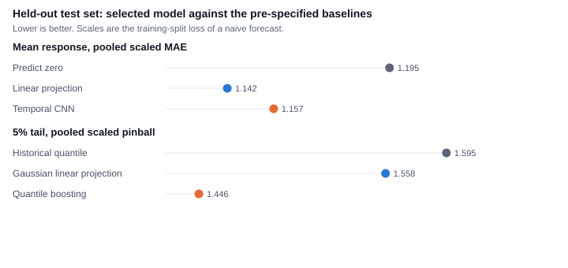

# Machine-learning study

Generated from `results/mlstudy/final.json`. Protocol tag `ml-study-v1`, config `ff092f530809`. This study does not replace the M5 benchmark in [ML_BENCHMARK.md](ML_BENCHMARK.md).

**Mean.** Temporal CNN minus the linear projection: 0.015 (90% CI -0.006 to 0.037). Verdict: No evidence ML adds value.

**Tail.** Quantile boosting minus the Gaussian linear projection, 5% pinball: -0.112 (90% CI -0.228 to -0.010). Verdict: ML adds value on the 5% tail.

| Question | Model | Score | Baseline | Difference (90% CI) | Verdict |
|---|---|---:|---:|---|---|
| Mean, pooled scaled MAE | Temporal CNN | 1.157 | linear 1.142 | 0.015 (-0.006 to 0.037) | No evidence ML adds value |
| Mean, predict zero | — | 1.195 | — | — | reported |
| 5% pinball | Quantile boosting | 1.446 | Gaussian 1.558 | -0.112 (-0.228 to -0.010) | ML adds value on the 5% tail |
| 5% pinball, historical | — | 1.595 | — | — | reported |

Test announcements: 168. Years 2019–2026. Walk-forward refit. Static-refit mean difference 0.026 (90% CI 0.006 to 0.046), which cannot change the verdict.

Validation scores, which chose the models and were not the test:

| Candidate | Validation score |
|---|---:|
| `zero` | 0.8800 scaled MAE |
| `lp` | 0.8364 scaled MAE |
| `mt_mlp:{"weight_decay": 0.001, "width": 32}` | 0.8867 scaled MAE |
| `mt_mlp:{"weight_decay": 0.01, "width": 32}` | 0.8866 scaled MAE |
| `mt_mlp:{"weight_decay": 0.001, "width": 64}` | 0.8870 scaled MAE |
| `mt_mlp:{"weight_decay": 0.01, "width": 64}` | 0.8864 scaled MAE |
| `tcn:{"channels": 8, "weight_decay": 0.001}` | 0.8867 scaled MAE |
| `tcn:{"channels": 8, "weight_decay": 0.01}` | 0.8876 scaled MAE |
| `tcn:{"channels": 16, "weight_decay": 0.001}` | 0.8846 scaled MAE |
| `tcn:{"channels": 16, "weight_decay": 0.01}` | 0.8847 scaled MAE |
| `hist` | 0.8607 scaled pinball |
| `gauss_lp` | 0.7569 scaled pinball |
| `qgbm:{"max_depth": 2}` | 0.7374 scaled pinball |
| `qgbm:{"max_depth": 3}` | 0.7433 scaled pinball |
| `qnet:{"weight_decay": 0.001, "width": 32}` | 0.8307 scaled pinball |
| `qnet:{"weight_decay": 0.01, "width": 32}` | 0.8687 scaled pinball |
| `qnet:{"weight_decay": 0.001, "width": 64}` | 0.8305 scaled pinball |
| `qnet:{"weight_decay": 0.01, "width": 64}` | 0.8732 scaled pinball |

90% interval coverage on the test set: linear 0.89, selected mean model 0.87. 5% hit rate: historical 0.07, Gaussian 0.06, selected tail model 0.09.

Fissler–Ziegel (secondary, lower is better): historical 0.776, Gaussian -1505.991, selected 0.688.

## Why the comparison looks like this

The mean-model point estimate is higher error than the linear projection (0.015), and the 90% interval includes zero, so the pre-registered rule is "No evidence ML adds value". Validation had already ranked every network behind the linear model; the test did not reverse that. The static refit, which cannot change the verdict, is "ML is worse" (difference 0.026, 90% CI 0.006 to 0.046). Pooling the assets and showing the network the pre-event path did not beat a linear function of the surprise.

The tail question is separate. The selected model's pinball difference is -0.112, and the whole interval is below zero: "ML adds value on the 5% tail". The same 5% quantile is crossed 0.09 of the time, against 0.06 for the Gaussian model, and the central interval covers 0.84 rather than 0.90. The gain is the scoring rule that was named in advance, not a claim of calibration.

The Fissler–Ziegel average is reported below and is not a decision. Yields are in basis points and equities in percent, and the exponential score lets one cell dominate, so a very negative Gaussian score is not evidence the Gaussian model is better.

## Embeddings, attribution, portfolio, stress

Asset-embedding adjusted Rand index against the pre-specified groups: 0.22 (permutation p 0.184). Descriptive.
Grouped Shapley shares of mean absolute contribution, horizon 1: surprise 0.45, family 0.17, macro_state 0.23, asset_vol 0.05, return_path 0.09. Efficiency gap 0.000000.
Equity book (CA_EQUITY_BOOK) scaled 5% pinball: selected 1.680, Gaussian 1.896, difference -0.216 (90% CI -0.552 to 0.092). Secondary.
Hypothetical FOMC surprise of 5.03 training standard deviations in the two-year futures surprise, model fit through 2018. Median and 5% quantile versus a zero-surprise row (not a test score):

| Asset | Median, zero | Median, shock | 5%, zero | 5%, shock |
|---|---:|---:|---:|---:|
| SPY | 0.02 | -0.14 | -1.27 | -1.67 |
| TSX | -0.05 | -0.09 | -0.82 | -1.17 |
| XEG | -0.17 | 0.05 | -1.94 | -2.19 |
| WTI | -0.09 | 0.08 | -3.25 | -4.65 |

Data vintage: 3 artifacts matched the committed pins and 22 were revised by the source after the pin date. Shock files are the matched ones when that count is the shock releases. The comparison is internal to this vintage. The M5 verdict stays the one in `results/final_eval/`.

