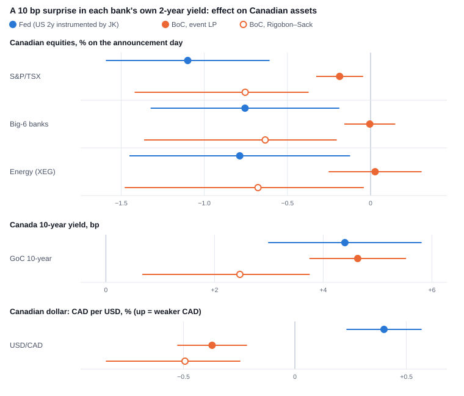
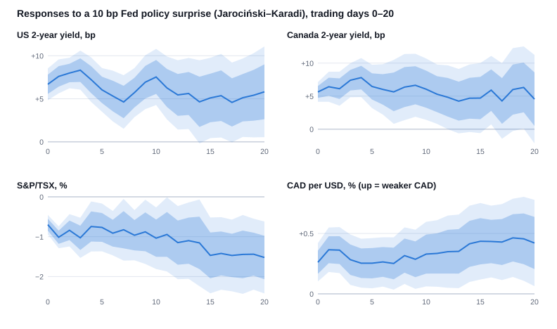
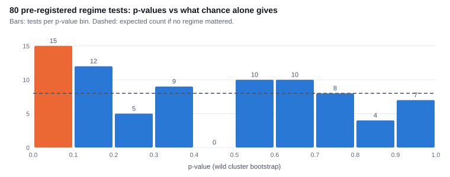
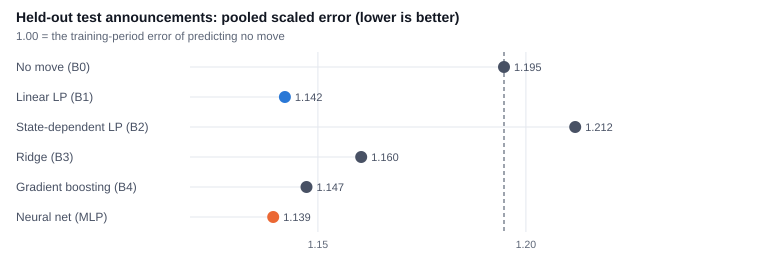

# How the World Moves Canada: Identified Shocks, State Dependence, and Whether ML Helps

*World Shock Lab research note. Generated by `uv run wsl report docs` from the result files committed in `results/`; every number in the text is read from them, and `tests/test_docs.py` fails if the note contains a number that is not, or if it no longer matches the results. Code, data provenance and the pre-registered protocol are in the repository.*

## Summary

- **Canada lens.** Scaling a Fed surprise and a Bank of Canada (BoC) surprise so that each lifts its own country's 2-year yield by 10 bp, the S&P/TSX moves −1.10% on the day of a Fed move (90% band −1.59 to −0.61) but −0.19% after a BoC move (−0.33 to −0.04), or −0.75% (−1.42 to −0.37) with the Rigobon–Sack estimator. By contrast, the Canadian 10-year yield rises +4.40 bp after the Fed and +4.64 bp after the BoC, and the Canadian dollar moves by similar amounts in opposite directions (CAD per USD +0.40% after a Fed hike surprise, −0.37% after a BoC one).
- **Machine learning.** On 168 held-out announcements (2019–2026), scored once under a protocol tagged in git before any model was fitted, the neural network's pooled scaled error minus the linear local projection's is −0.003 (90% CI −0.019 to +0.014): no evidence that ML adds value.
- **State dependence.** None of 80 pre-registered regime tests survives false-discovery control (15 have p ≤ 0.10 before correction; about 8 would by chance).
- **Credibility.** 11 of 13 published findings replicate. In simulation, the primary estimator's 90% bands contain the true response 90% of the time. Every result is labelled *identified causal*, *reduced form*, *model forecast* or *hypothetical scenario*.

## 1. The question

How do markets around the world, and in Canada in particular, react to monetary policy surprises from the Federal Reserve and the BoC, to oil supply news, and to jumps in geopolitical and trade-policy risk? Does the same shock matter more in some states of the economy? And can machine learning forecast announcement-day moves better than a linear econometric model? The answers feed a scenario tool in which each response carries its uncertainty and its evidence label.

## 2. Data and identification

**The Fed.** Jarociński and Karadi (2020) measure the change in interest-rate futures in a 30-minute window around each FOMC announcement and split it, using the co-movement of stock prices, into a *policy* surprise and an *information* surprise. Almost nothing else moves markets in those 30 minutes, which is what makes the responses causal.

**The Bank of Canada.** No free intraday Canadian data exist, so the BoC surprise is a *daily-window proxy*: the change in the Government of Canada 2-year yield on scheduled announcement days, from a list of 195 decisions built from the BoC's own press releases. Decisions on FOMC days are excluded (protocol v2), because their daily window also contains the Fed. Before use, the proxy was validated. The variance of the 2-year change on announcement days is 2.82 times that on matched control days (90% CI 1.99 to 4.00), and 5.71 times (3.92 to 8.27) after removing the same-day US 2-year move. It still carries some common North American rate news, so the heteroskedasticity-based estimator of Rigobon and Sack (2004) is reported next to every BoC result.

**Oil and risk.** Oil supply news comes from Känzig (2021), who measures oil-futures moves around OPEC announcements. The geopolitical risk index of Caldara and Iacoviello (2022) and the trade-policy uncertainty index of Caldara et al. (2020) measure news intensity, not exogenous shocks, so every result that uses them is labelled *reduced form*.

**Markets.** US Treasury yields (H.15) and exchange rates (H.10, the New York noon fix) come from FRED. Government of Canada yields come from the BoC's Valet service. Equity prices, including an equal-weight total-return index of the six largest Canadian banks, come from Yahoo Finance, whose terms allow only derived statistics to be published. Country equity responses use US-listed iShares ETFs, priced in US dollars.

**Timing.** Every series is measured from its last observation before the announcement to the h-th observation after it, at its own observation time. A 14:00 FOMC statement therefore appears in noon-fixed exchange rates a day later than in 16:00 stock closes.

## 3. Methods

**Daily responses.** For each horizon h = 0 to 20 trading days, an event-sample local projection (Jordà, 2005) regresses the cumulative change on the surprise, controlling for the five pre-event daily changes (and, for the Fed, the other Jarociński–Karadi surprise), with HC3 standard errors. This specification was fixed before estimation. In a simulation with sparse, fat-tailed shocks like announcement surprises, its 90% bands contain the true response 90% of the time. A time-series projection with zero-filled shocks and Newey–West errors manages only 86%, so it is used only as a robustness check.

**Monthly macro.** Each LP-IV result reports the effective first-stage F (Montiel Olea and Pflueger, 2013) and the weak-instrument-robust Anderson–Rubin (1949) set. A proxy VAR with Minnesota shrinkage and moving-block bootstrap bands (Jentsch and Lunsford, 2019) estimates the same responses. In simulation its 90% bands contain the truth only 84% of the time, the small-sample problem Kilian (1998) documents. Where it disagrees with the LP, the LP bands are the better guide to uncertainty (Plagborg-Møller and Wolf, 2021).

**State dependence.** A stacked local projection interacts the surprise with a regime measured before each announcement: VIX above its one-year median, the 6-month direction of the policy rate, or inflation above 3%. It is tested jointly over all horizons and at the one-week headline horizon, with p-values from a wild cluster bootstrap. All 80 tests form one Benjamini–Hochberg (1995) family.

**Pre-registration.** Before any model was fitted, the time splits were fixed in a protocol tagged in git: training to 2014, validation 2015–2018, test 2019–2026. The protocol also fixed the metrics, the rule for whether ML "adds value", the regime tests and the robustness rule. Every later change is logged with its reason, and the test set was scored once.

## 4. Results

### 4.1 Credibility checks

Of 13 findings from the papers whose shocks we use, 11 replicate: the sign matches and the 90% band excludes zero. 2 more have the right sign but a band that includes zero, and none have the wrong sign. Some claims are close to true by construction (the 30-minute surprise sits inside the daily window); among the 7 that are not, 6 replicate. In placebo tests the real surprises are moved to 1,000 sets of random non-announcement days. For the Fed's effects on the US 2-year yield and US stocks and OPEC news's effect on oil, no placebo draw is as large as the real estimate.

### 4.2 The Canada lens

*Figure 1. Effect on the announcement day of a surprise that raises the announcing bank's own 2-year yield by 10 bp; 90% intervals. The Fed's US 2-year move is instrumented by the JK policy surprise (first-stage F at least 24).*

The Fed matters more for Canadian equities: the S&P/TSX moves −1.10% on the day of a Fed move (90% band −1.59 to −0.61) but −0.19% after a BoC move (−0.33 to −0.04), or −0.75% (−1.42 to −0.37) with the Rigobon–Sack estimator. The same holds for the Big-6 banks: −0.76% after the Fed (−1.32 to −0.19) against 0.00% after the BoC (−0.16 to +0.15; Rigobon–Sack −0.63%). One week later the Fed's effect on the S&P/TSX is still −1.21% (−2.01 to −0.40). For the BoC it is −0.20% in the event LP and −1.00% with Rigobon–Sack.

The two estimators for the BoC differ. The event LP assumes the proxy contains only BoC news. Rigobon–Sack does not, and it gives larger equity effects. The size of the Fed's lead therefore depends on the estimator, but its direction does not. Rates and the currency behave symmetrically: the Canadian 10-year yield rises +4.40 bp after the Fed and +4.64 bp after the BoC, and the Canadian dollar moves by similar amounts in opposite directions (CAD per USD +0.40% after a Fed hike surprise, −0.37% after a BoC one).

### 4.3 How a Fed surprise spreads

*Figure 2. Responses to a 10 bp Jarociński–Karadi policy surprise, with 68% and 90% bands.*

Across 318 shock-to-asset responses at one and five days, 126 survive Benjamini–Hochberg control. The strongest are hawkish Fed surprises lowering equity prices around the world and raising yields. Of the 30 headline responses, 24 keep their sign in every pre-registered variant and are significant in at least two thirds of them. The variants are subsamples before and after 2008, excluding 2020, other controls, other Fed shock measures and other estimators. The fragile ones are the BoC's equity effects and the Fed's one-week effect on Canadian banks.

### 4.4 Oil supply news: exporters and importers

Every country ETF rises on news of tighter oil supply, and the ordering follows oil exposure. But the difference between exporters and importers on the day is +0.06% (90% band 0.00 to +0.12, p = 0.11): not significant. The ETFs are priced in US dollars, and OPEC news may coincide with global demand news.

### 4.5 State dependence

*Figure 4. If no regime mattered, the p-values would be roughly uniform (dashed line). The lowest bin is above it, but no test survives false-discovery control.*

Before correction, 15 of 80 tests have p ≤ 0.10, against about 8 expected by chance; none survives. This does not show that regimes are irrelevant. With a few hundred announcements split into regimes, only large differences are detectable, and the minimum detectable effect is reported for every cell (docs/RESULTS.md). The most suggestive cells, such as a smaller Fed effect on the US 2-year when VIX is high, are hypotheses for the live data to test.

### 4.6 Monthly macro effects: weak instruments

At the monthly frequency, identification is weak. The first-stage F of the orthogonalized Bauer–Swanson (2023) surprise is 3.1 in the VAR and 5.5 in the LP-IV, over 276 months. The LP-IV shows the textbook contraction: US industrial production is −2.09% after a year (90% band −3.95 to −0.23) for a shock that raises the 1-year yield 25 bp. Here, and for US and Canadian prices after two years, the Anderson–Rubin sets exclude zero but are very wide. These are the project's least reliable results and are labelled suggestive.

### 4.7 Does machine learning help?

*Figure 3. Pooled scaled error on the held-out test announcements: each asset's mean absolute error divided by its training-period error from predicting no move, averaged over 8 assets × 2 horizons.*

Six models predict the 1-day and 5-day move of eight assets after each FOMC, BoC and OPEC announcement. They use only the announcement's own surprise components and the state of the economy before it, and are refit every year on earlier data. The baselines are a zero forecast, a linear LP, a state-dependent LP and ridge regression. The ML models are gradient boosting and a small neural network. The validation years chose the linear LP as the econometric candidate and the neural network as the ML candidate.

On 168 held-out announcements (2019–2026), scored once under a protocol tagged in git before any model was fitted, the neural network's pooled scaled error minus the linear local projection's is −0.003 (90% CI −0.019 to +0.014). The interval includes zero, so the verdict, computed by the pre-registered rule, is: **No evidence ML adds value**. The ML models rely almost entirely on the surprise itself: shuffling the surprise components raises their error by up to 0.120, while shuffling any state variable changes it by much less. Refitting once rather than every year gives the same verdict (difference +0.003, CI −0.011 to +0.017).

## 5. Live, pre-registered forecasts

Before each Fed and BoC decision, a conditional forecast is committed to the repository: if the announcement moves the bank's own 2-year yield by −10, 0, +10 bp, here is the expected move in the Canadian 2-year yield, the Canadian dollar and Canadian banks on the first and fifth trading days after it. Each comes with 68% and 90% ranges for the outcome. The forecasts are never edited. A scheduled job scores them once the outcomes are published, against the realized daily move and later against the 30-minute surprise. The model is a deliberately simple proxy regression with jackknife prediction intervals (Barber et al., 2021). It is a forecast, not a causal estimate: the daily 2-year move mixes policy and information news, which is why its bank-stock slopes are near zero. The first forecasts, for the decisions of 2026-10-28, were published on 2026-10-13; both banks announce that day, so they are flagged as a collision and summarized separately.

## 6. Limitations

The responses are averages over past announcements, and scenarios add them as if effects were linear. The BoC proxy is noisier than the Fed's intraday measure. Country equity responses mix stock and currency moves. Monthly identification is weak. Trade-policy and geopolitical results are associations, not causal effects. The full list is in `docs/LIMITATIONS.md`.

## 7. Reproducing

`make all` rebuilds everything from the pinned raw downloads: data, simulations, replication, the M4 analysis, the site data and these documents. A free FRED API key is needed. `docs/REPRODUCING.md` describes what changes when sources have revised their data since the pins.

## References

- Anderson, T. W. and Rubin, H. (1949). Estimation of the Parameters of a Single Equation in a Complete System of Stochastic Equations. *Annals of Mathematical Statistics* 20(1): 46–63.
- Barber, R. F., Candès, E. J., Ramdas, A. and Tibshirani, R. J. (2021). Predictive Inference with the Jackknife+. *Annals of Statistics* 49(1): 486–507.
- Bauer, M. D. and Swanson, E. T. (2023). A Reassessment of Monetary Policy Surprises and High-Frequency Identification. *NBER Macroeconomics Annual* 37.
- Benjamini, Y. and Hochberg, Y. (1995). Controlling the False Discovery Rate: A Practical and Powerful Approach to Multiple Testing. *Journal of the Royal Statistical Society Series B* 57(1): 289–300.
- Caldara, D. and Iacoviello, M. (2022). Measuring Geopolitical Risk. *American Economic Review* 112(4): 1194–1225.
- Caldara, D., Iacoviello, M., Molligo, P., Prestipino, A. and Raffo, A. (2020). The Economic Effects of Trade Policy Uncertainty. *Journal of Monetary Economics* 109: 38–59.
- Gneiting, T. and Raftery, A. E. (2007). Strictly Proper Scoring Rules, Prediction, and Estimation. *Journal of the American Statistical Association* 102(477): 359–378.
- Jarociński, M. and Karadi, P. (2020). Deconstructing Monetary Policy Surprises – The Role of Information Shocks. *American Economic Journal: Macroeconomics* 12(2).
- Jentsch, C. and Lunsford, K. G. (2019). The Dynamic Effects of Personal and Corporate Income Tax Changes in the United States: Comment. *American Economic Review* 109(7): 2655–2678.
- Jordà, Ò. (2005). Estimation and Inference of Impulse Responses by Local Projections. *American Economic Review* 95(1): 161–182.
- Känzig, D. R. (2021). The Macroeconomic Effects of Oil Supply News: Evidence from OPEC Announcements. *American Economic Review* 111(4): 1092–1125.
- Kilian, L. (1998). Small-Sample Confidence Intervals for Impulse Response Functions. *Review of Economics and Statistics* 80(2): 218–230.
- Montiel Olea, J. L. and Pflueger, C. (2013). A Robust Test for Weak Instruments. *Journal of Business & Economic Statistics* 31(3): 358–369.
- Plagborg-Møller, M. and Wolf, C. K. (2021). Local Projections and VARs Estimate the Same Impulse Responses. *Econometrica* 89(2): 955–980.
- Rigobon, R. and Sack, B. (2004). The Impact of Monetary Policy on Asset Prices. *Journal of Monetary Economics* 51(8): 1553–1575.
